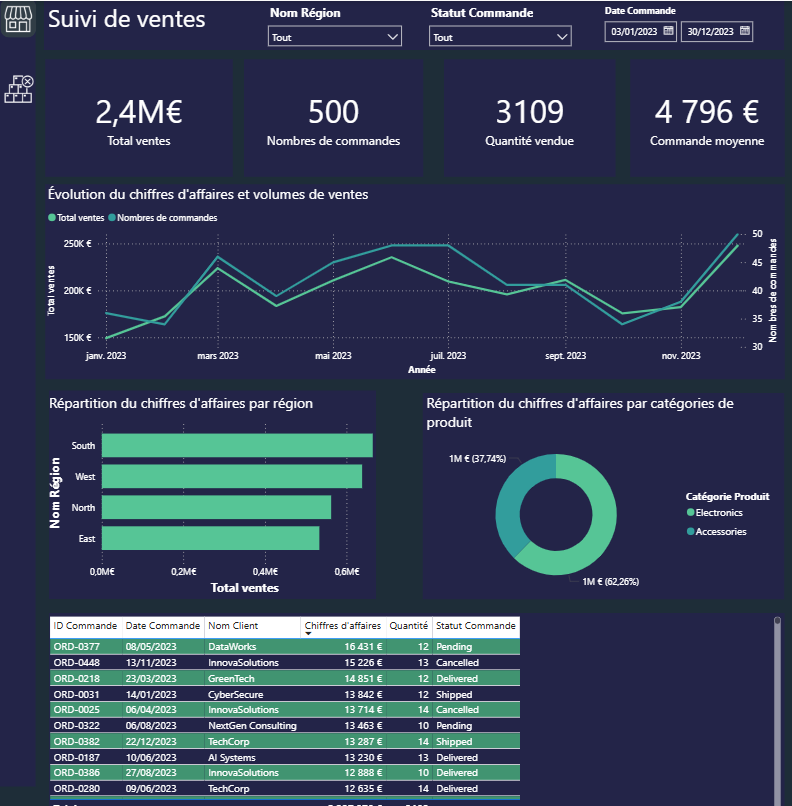
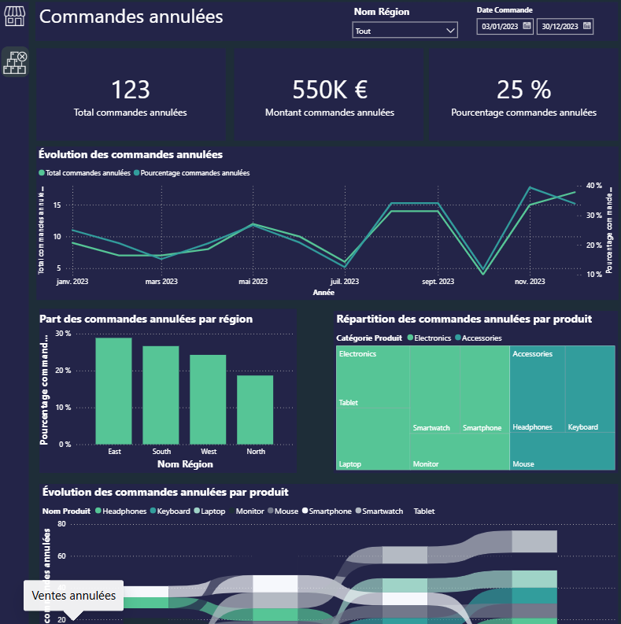
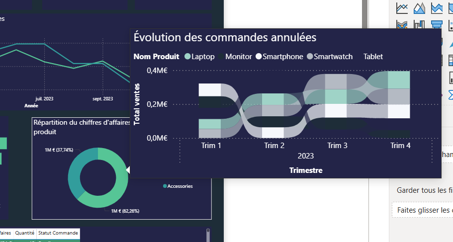
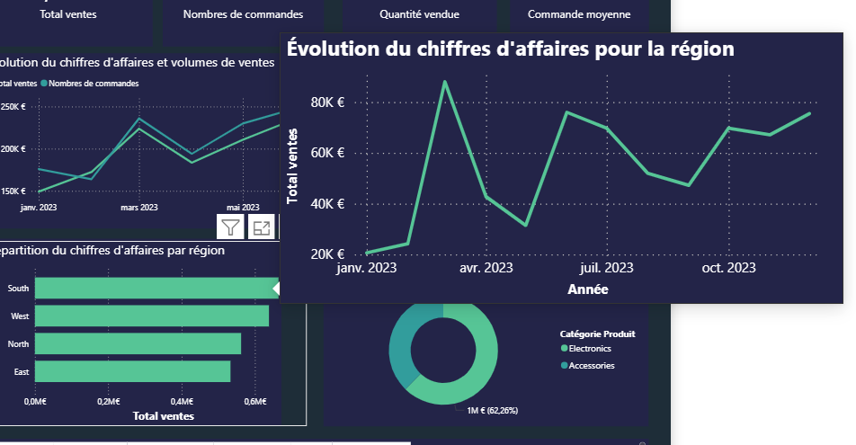

# Tableau de bord des ventes – Power BI

Rapport Power BI interactif qui suit les ventes d'une entreprise de matériel informatique sur l'année 2023 : chiffre d'affaires, volumes, répartition par région et par produit, et analyse des commandes annulées.

> Projet personnel réalisé pour pratiquer Power Query, la modélisation en étoile et le langage DAX.

## Chiffres clés (année 2023)

| Indicateur | Valeur |
|---|---|
| Chiffre d'affaires | 2,4 M€ |
| Commandes | 500 |
| Quantité vendue | 3 109 unités |
| Commande moyenne | 4 796 € |
| Commandes annulées | 123, soit 25 % (550 k€) |

## Page 1 – Suivi des ventes

- Quatre indicateurs en tête de page : chiffre d'affaires, nombre de commandes, quantité vendue, commande moyenne.
- Évolution mensuelle du chiffre d'affaires et du nombre de commandes.
- Répartition du chiffre d'affaires par région (la région **South** arrive en tête) et par catégorie de produit (**Electronics** : 62 %, **Accessories** : 38 %).
- Tableau détaillé des commandes, trié par chiffre d'affaires.
- Filtres : région, statut de commande, période.

## Page 2 – Commandes annulées

- 123 commandes annulées sur 500, soit **25 %** et **550 k€** de chiffre d'affaires perdu.
- Évolution mensuelle du nombre et du pourcentage de commandes annulées.
- Part des annulations par région : la plus forte à l'**Est** (près de 29 %), la plus faible au **Nord** (près de 19 %).
- Répartition des annulations par produit et évolution par produit au fil de l'année.

## Infobulles personnalisées

Au survol d'une région ou d'un produit, une infobulle affiche un graphique détaillé.

| Évolution du chiffre d'affaires d'une région | Évolution des annulations par produit |
|---|---|
|  |  |

## Démarche

1. **Power Query** : nettoyage et fiabilisation des données (types, valeurs manquantes, doublons).
2. **Modélisation en étoile** : une table de faits des commandes reliée à des tables de dimensions.
3. **DAX** : mesures pour le chiffre d'affaires, le nombre de commandes, la commande moyenne, le montant et le pourcentage de commandes annulées.
4. **Visualisation** : deux pages de rapport, des filtres et des infobulles personnalisées.

## Données

Jeu de données de ventes 2023 : commandes, clients, produits (8 produits en 2 catégories), régions (4) et statut de commande. Source : jeu de données fictif d'entraînement (entreprises et clients inventés).

## Outils

Power BI Desktop · Power Query · DAX
